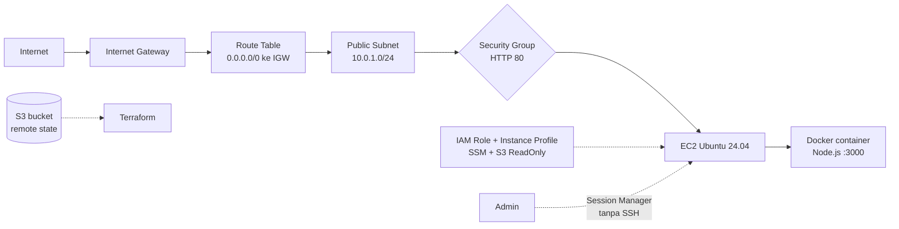

# terraform-aws-docker-ec2

Infrastructure as Code untuk menjalankan aplikasi Docker di AWS EC2 dengan satu perintah. Proyek ini adalah kelanjutan dari setup manual lewat console: semua resource yang dulu dibuat dengan klik sekarang didefinisikan sebagai kode, dapat diulang, dan dapat dihapus bersih dengan `terraform destroy`.

## Arsitektur



## Yang dibuat

| Resource | Keterangan |
|---|---|
| `aws_vpc` | VPC `10.0.0.0/16` |
| `aws_subnet` | Subnet publik `10.0.1.0/24`, auto-assign public IP |
| `aws_internet_gateway` | Jalur keluar-masuk ke internet |
| `aws_route_table` + association | Route `0.0.0.0/0` ke IGW, dikaitkan ke subnet |
| `aws_security_group` | Hanya ingress HTTP (80); tidak ada port 22 |
| `aws_iam_role` + policy + instance profile | `AmazonSSMManagedInstanceCore` dan `AmazonS3ReadOnlyAccess` |
| `aws_instance` | `t3.micro`, Ubuntu 24.04 (AMI dicari otomatis), IMDSv2 wajib |

Saat boot pertama, `user_data` memasang Docker, membuat aplikasi Node.js kecil beserta Dockerfile, lalu menjalankannya dengan `--restart unless-stopped` di port 80.

## Struktur repo

```
.
├── main.tf              # provider, backend S3, jaringan
├── compute.tf           # security group, IAM, EC2, user_data
├── variables.tf         # region, CIDR, instance type, nama proyek
├── .terraform.lock.hcl  # versi provider yang dikunci
└── .gitignore           # state dan folder .terraform tidak ikut commit
```

## Prasyarat

- Terraform **>= 1.10** (state locking bawaan S3 memakai `use_lockfile`)
- AWS CLI v2 dengan kredensial IAM user khusus Terraform (`aws configure`)
- Akun AWS dengan akses ke region `ap-southeast-1`

## Cara pakai

### 1. Buat bucket untuk remote state (sekali saja, manual)

Bucket state tidak bisa dibuat oleh Terraform yang state-nya disimpan di bucket itu sendiri, jadi dibuat di luar Terraform:

```bash
BUCKET="tfstate-<nama-unik>"

aws s3api create-bucket --bucket "$BUCKET" --region ap-southeast-1 \
  --create-bucket-configuration LocationConstraint=ap-southeast-1

aws s3api put-bucket-versioning --bucket "$BUCKET" \
  --versioning-configuration Status=Enabled

aws s3api put-public-access-block --bucket "$BUCKET" \
  --public-access-block-configuration BlockPublicAcls=true,IgnorePublicAcls=true,BlockPublicPolicy=true,RestrictPublicBuckets=true
```

Lalu isi nama bucket di blok `backend "s3"` pada `main.tf`. Blok backend tidak boleh memakai variabel, jadi nama ditulis langsung.

### 2. Jalankan Terraform

```bash
terraform init
terraform plan
terraform apply
```

Setelah apply selesai, tunggu 2-3 menit agar `user_data` selesai, lalu buka `http://<public_ip>` (output `public_ip`). Hasilnya JSON dari aplikasi di dalam container.

### 3. Akses server tanpa SSH

Gunakan **EC2 → Instances → Connect → Session Manager**. Tidak ada port 22 yang terbuka dan tidak ada key `.pem` yang perlu dikelola.

### 4. Hapus semua resource

```bash
terraform destroy
```

Bucket state tidak ikut terhapus, dan memang tidak boleh dihapus.

## Variabel

| Variabel | Default | Fungsi |
|---|---|---|
| `region` | `ap-southeast-1` | Region AWS |
| `vpc_cidr` | `10.0.0.0/16` | CIDR VPC |
| `subnet_cidr` | `10.0.1.0/24` | CIDR subnet publik |
| `instance_type` | `t3.micro` | Tipe instance |
| `project_name` | `tf-belajar` | Awalan nama resource |

Contoh menimpa nilai tanpa mengedit file:

```bash
terraform plan -var="instance_type=t3.small"
```

## Keputusan desain

- **Tanpa SSH.** Akses lewat SSM Session Manager menghilangkan masalah IP yang berganti-ganti dan port 22 yang diblokir jaringan, sekaligus mengurangi permukaan serangan.
- **IMDSv2 wajib** (`http_tokens = "required"`).
- **IAM role, bukan access key**, untuk akses instance ke layanan AWS.
- **Remote state di S3** dengan versioning, enkripsi, block public access, dan locking bawaan.
- **Provider dikunci** lewat `.terraform.lock.hcl` supaya hasilnya konsisten antar mesin.

## Pelajaran yang didapat

1. **`~` bukan `-/+`, dan keduanya perlu dibaca di plan.** Mengubah tag subnet atau tipe instance diterapkan *in-place*, sedangkan mengubah `cidr_block` subnet memaksa penggantian (`-/+`) dan ikut menggantikan resource yang bergantung padanya. Menebak dari jenis perubahan tidak bisa diandalkan; plan-lah sumber kebenarannya.
2. **Plan dari kondisi kosong tidak membuktikan refactor aman.** Setelah memindahkan nilai ke variabel, buktinya adalah `apply` lalu `plan` lagi yang menghasilkan *No changes*.
3. **AMI dengan `most_recent = true` bisa memicu penggantian instance** saat AMI baru terbit, padahal kode tidak berubah. Untuk instance berumur panjang, pertimbangkan `lifecycle { ignore_changes = [ami] }`.
4. **`user_data` hanya berjalan pada boot pertama.** Karena itu `user_data_replace_on_change = true` dipakai agar perubahan skrip menghasilkan instance baru.
5. **Perubahan tipe instance tidak bebas gangguan.** Meski in-place, instance berhenti sebentar dan public IP berganti (belum memakai Elastic IP).
6. **Jangan pernah menempel access key di terminal yang bisa terlihat orang lain, di chat, atau di screenshot.** Key yang terlanjur terlihat harus dinonaktifkan dan dibuat ulang.

## Biaya

Semua resource jaringan gratis. Biaya hanya datang dari EC2 yang menyala, jadi jalankan `terraform destroy` setelah selesai berlatih. Pasang budget alert di AWS Budgets sebelum memulai.

## Pengembangan berikutnya

- [ ] Pecah menjadi module (`network`, `compute`)
- [ ] Ganti user_data dengan image dari **Amazon ECR** dan build lewat **GitHub Actions**
- [ ] Tambahkan Application Load Balancer dan Auto Scaling
- [ ] Tambahkan monitoring dasar dengan CloudWatch
